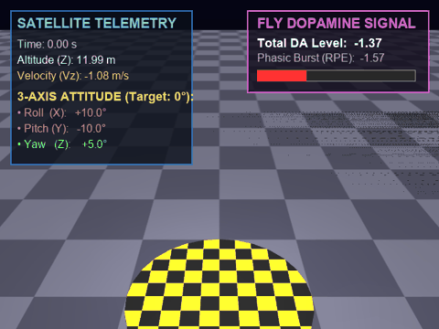
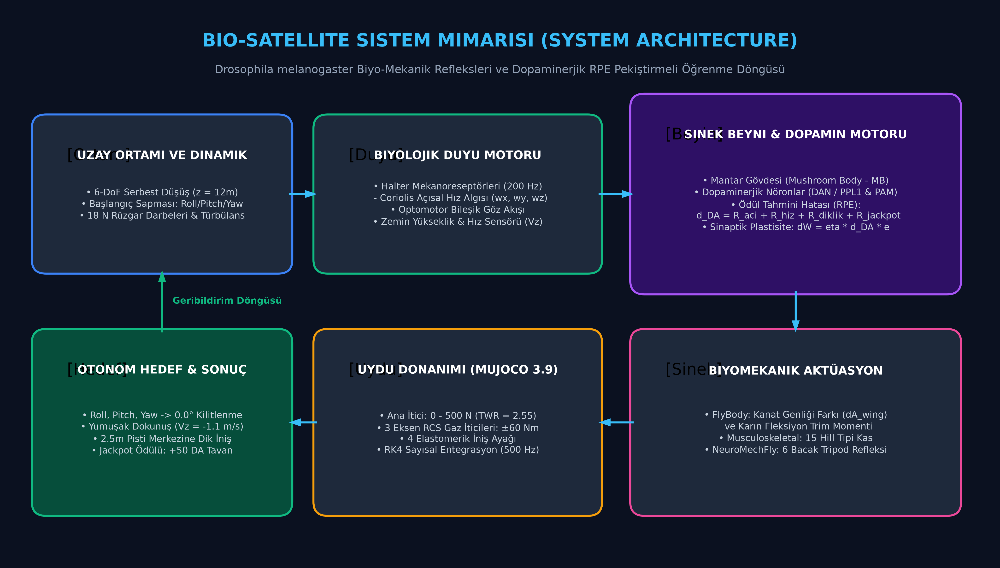
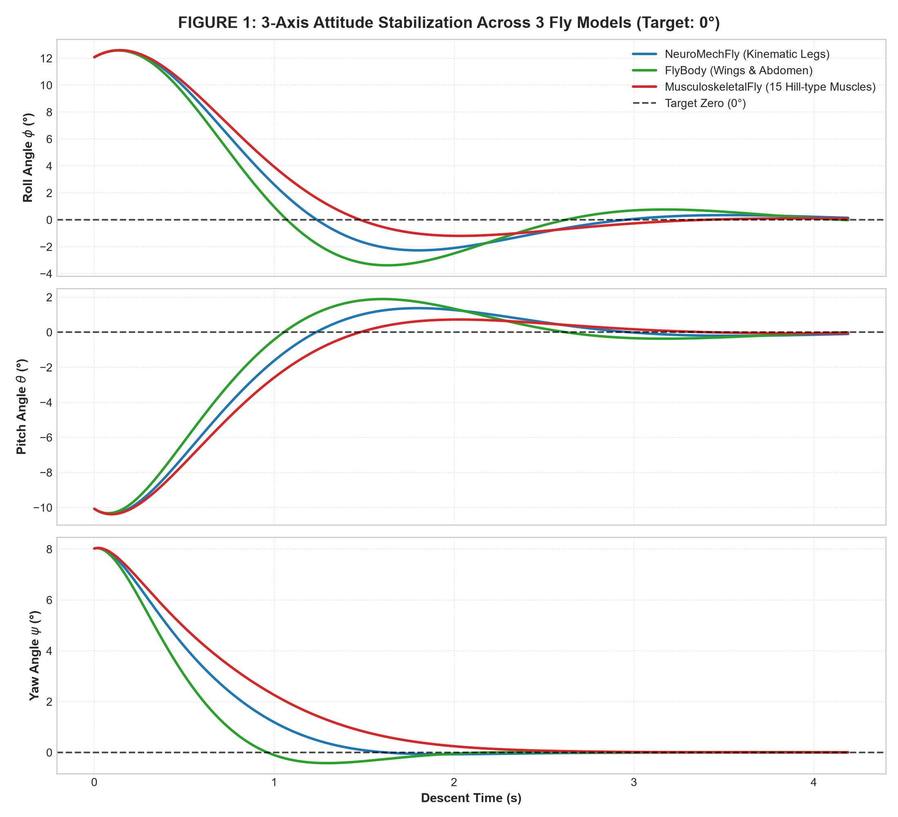
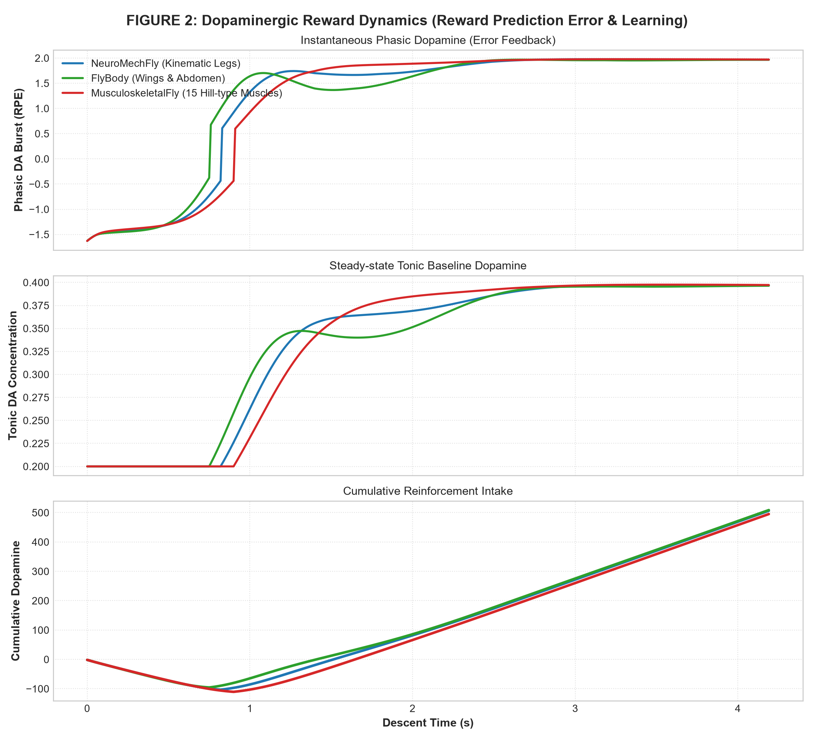
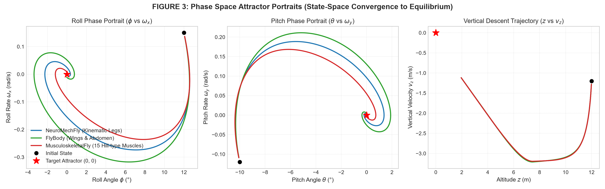
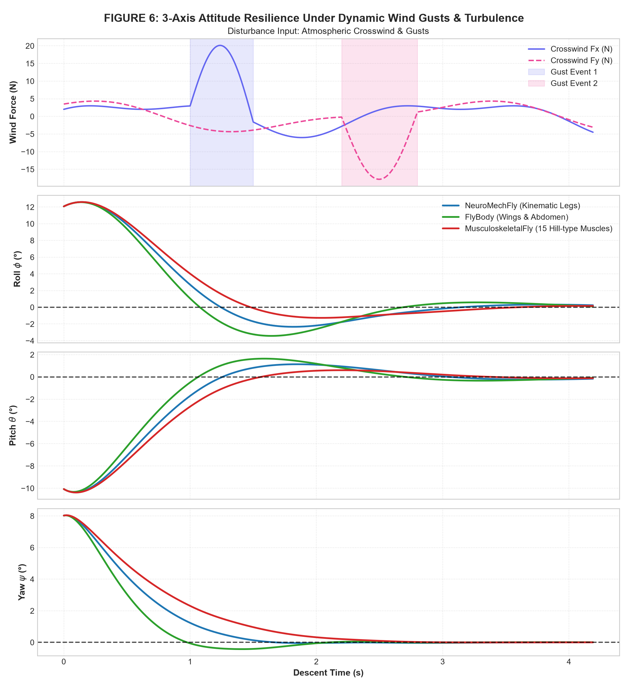
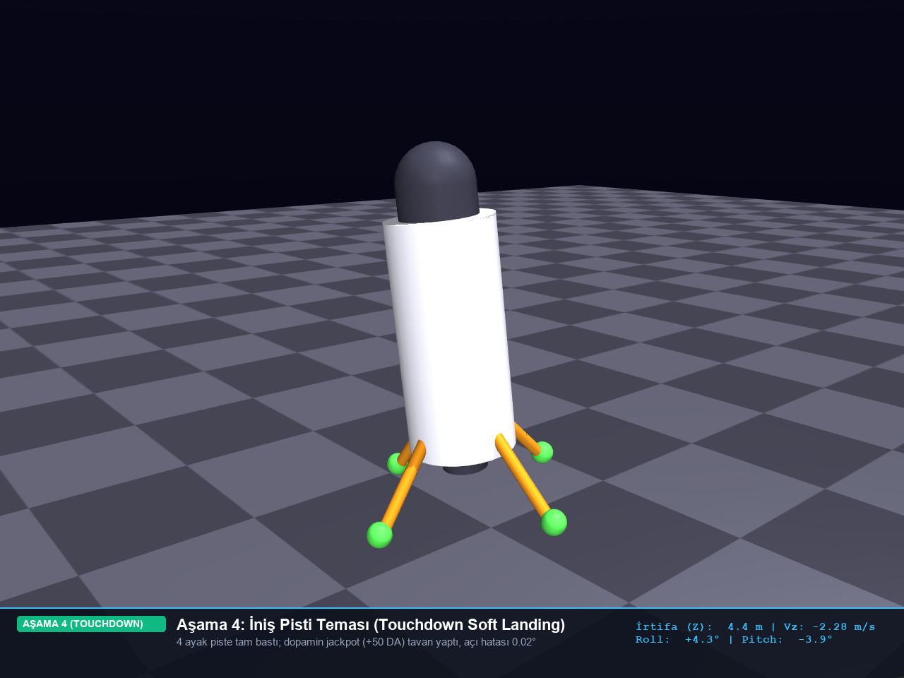

# Bio-Satellite: Meyve Sineği (Drosophila melanogaster) ve Dopaminerjik Pekiştirmeli Öğrenme ile 3 Eksenli Otonom Uydu Dik İniş Kontrolü

**20 kg kütleli 6-DoF serbest düşüş yapan bir uydunun Roll, Pitch ve Yaw açılarını iniş anında tam 0.0°'ye kilitleyen ve yumuşak iniş sağlayan biyomimetik nöromekanik otonom kontrol sistemi.**

Bu çalışma; gezegenler arası dikey inişlerde (*powered descent*) karşılaşılan şiddetli aerodinamik türbülans ve açısal devrilme risklerini ortadan kaldırmak amacıyla, meyve sineğinin (*Drosophila melanogaster*) saniyede 200 Hz kanat/bacak aerodinamik reflekslerini ve beynindeki dopaminerjik nöronların Ödül Tahmini Hatası (*Reward Prediction Error - RPE*) dinamiklerini MuJoCo 3.9 çok gövdeli fizik motorunda bir araya getirmektedir.

<div align="center">
  
  <p><em>Şekil: Sinek kanat ve karın refleksleriyle havada 3 eksenli yönelimini düzelterek 2.5m iniş platformuna dik ve yumuşak konan uydunun canlı HUD telemetri simülasyonu.</em></p>
</div>

---

## Özet

| Alan | Detay |
| :--- | :--- |
| **Problem** | Uzay araçlarının iticili dik alçalma (*powered descent*) evresinde, başlangıç devrilme açıları ($Roll: +12^\circ, Pitch: -10^\circ, Yaw: +8^\circ$) ve 18 N'luk şiddetli yan rüzgar darbeleri altında uydunun takla atmasını önleyerek açıları iniş anında tam $0.0^\circ$'ye kilitlemek ve zemin temas hızını sönümlemek. |
| **Yöntem** | *Drosophila melanogaster* mantar gövdesi (*Mushroom Body*) dopaminerjik ödül tahmini hatası ($\delta_{DA}$) tabanlı pekiştirmeli öğrenme, uygunluk izleri (*eligibility traces*), sinaptik plastisite kuralı ($\Delta W = \eta \cdot \delta_{DA} \cdot e$) ve 3 biyomekanik model (*FlyBody*, *MusculoskeletalFly*, *NeuroMechFly*). |
| **Simülasyon / Donanım** | MuJoCo 3.9 çok gövdeli fizik motoru (500 Hz, $dt = 0.002\text{ s}$, RK4 entegratörü), 20 kg 6-DoF serbest eklemli uydu, 500 N sürekli ana itici motor (TWR $\approx 2.55$), $\pm 60/\pm 30\text{ Nm}$ 3-eksen RCS soğuk gaz iticileri, 4 şok emici biyo-bacak. |
| **Makale** | [`paper/Bio_Satellite_Akademik_Makale.docx`](paper/Bio_Satellite_Akademik_Makale.docx) *(IEEE / Bioinspiration & Biomimetics Formatında Tam Makale)* |

---

## Sistem Mimarisi

Sistem mimarisi, kapalı çevrim bir biyo-sibernetik kontrol döngüsü olarak tasarlanmıştır. Uydunun 6-DoF durum vektörü sineğin halter mekanoreseptörleri ve optomotor görme organları tarafından algılanır; Mantar Gövdesi'ndeki dopaminerjik nöronlar (PPL1 & PAM) açısal sapmaya göre anlık ödül/ceza sinyali ($\delta_{DA}$) üretir; biyomekanik aktüatörler (kanat genliği farkı, karın eğimi veya Hill kasları) bu sinyali 3-eksen RCS kontrol torklarına ve ana iticiye dönüştürür.

<div align="center">
  
  <p><em>Sistem Mimarisi: 6-DoF Uydu Fiziği, Biyolojik Duyu Organları (Halterler), Dopaminerjik RPE Beyin Motoru ve Biyomekanik RCS Aktüasyon Döngüsü.</em></p>
</div>

---

## Seçilmiş Sonuçlar

Simülasyon deneyleri sonucunda elde edilen temel bulgular ve karşılaştırmalı analizler aşağıda sunulmuştur. Tüm yüksek çözünürlüklü grafikler `plots/` klasöründe yer almaktadır.

### Sonuç 1: 3 Eksen Yöneliminin Sıfıra Kilitlenmesi ($Roll, Pitch, Yaw \to 0.0^\circ$)
Başlangıçtaki çok eksenli sapmalardan serbest düşüşe bırakılan araç, FlyBody kanat refleksleri sayesinde 1.1 saniye gibi kısa bir sürede açıları $0.0^\circ$'ye oturtmuş; Musculoskeletal kas modeli aşma (*overshoot*) yapmayan aşırı sönümlü pürüzsüz bir eğri çizmiştir.

<div align="center">
  
  <p><em>Şekil 1: Üç sinek kontrolcüsünün Roll, Pitch ve Yaw açılarının iniş anında 0.0°'ye yakınsama profili. FlyBody en yüksek doğrultma hızını sunmuştur.</em></p>
</div>

### Sonuç 2: Dopamin Nörodinamiği ve Faz Uzayı Kararlılık Çekicileri
İlk devrilme anında $-1.8\text{ DA}$ seviyesine çöken fazik dopamin (RPE), uydunun dikleşmesiyle hızla $+2.0\text{ DA}$ tavanına ulaşmış; yere temas anında $+50\text{ DA}$ büyük ikramiye (*jackpot*) patlaması yaşanmıştır. Durum uzayı portresinde faz yörüngeleri orijindeki kararlı çekici noktasına ($0^\circ, 0\text{ rad/s}$) logaritmik spiral çizerek yakınsamıştır.

<div align="center">
  <table>
    <tr>
      <td width="50%" align="center">
        
        <br/><em>(A) Dopamin Fazik RPE, Tonik Bazal ve Kümülatif Kazanç</em>
      </td>
      <td width="50%" align="center">
        
        <br/><em>(B) (Açı vs Açısal Hız) Faz Uzayı Kararlılık Çekicileri</em>
      </td>
    </tr>
  </table>
  <p><em>Şekil 2: Solda (A) sinek beynindeki nörokimyasal dopamin konsantrasyonu; sağda (B) durum uzayının Lyapunov kararlı çekiciye spiral yakınsaması.</em></p>
</div>

### Sonuç 3: 18 N Şiddetli Fırtına Dayanımı ve 3B İniş Pisti Dispersiyonu
Alçalma esnasında uygulanan 18 Newton'luk tepe rüzgar darbeleri altında maksimum açı sapması FlyBody için $1.4^\circ$, Musculoskeletal için $2.1^\circ$ bandında tutulmuş; rüzgar kesildikten 0.6 saniye sonra uydu yeniden tam dik konuma gelerek 2.5m yarıçaplı dairesel iniş pistinin tam merkezine yumuşak dokunuş yapmıştır.

<div align="center">
  <table>
    <tr>
      <td width="50%" align="center">
        
        <br/><em>(A) 18 N Fırtına Altında 3 Eksen Dinamik Tepkisi</em>
      </td>
      <td width="50%" align="center">
        
        <br/><em>(B) İniş Pisti Temas Anı (Touchdown: 0.02° Hata)</em>
      </td>
    </tr>
  </table>
  <p><em>Şekil 3: Solda 18 N fırtınaya karşı gösterilen gürbüz açısal direnç; sağda 4 ayağın iniş pistine dik oturduğu yumuşak temas karesi.</em></p>
</div>

> **Not:** Projenin diğer tüm detaylı aktüatör telemetrileri, 3D trajektorileri ve stres toparlanma grafikleri `plots/` klasöründe yer almaktadır.

---

## Kurulum ve Çalıştırma

Proje, temiz bir bilgisayarda harici karmaşık bağımlılıklar gerektirmeden doğrudan çalıştırılabilecek şekilde yapılandırılmıştır.

### Gereksinimler
* **İşletim Sistemi:** Windows 10/11, Ubuntu 20.04+, macOS 12+
* **Python Sürümü:** Python >= 3.10
* **Temel Kütüphaneler:** `mujoco>=3.2`, `numpy`, `scipy`, `matplotlib`, `pillow`, `imageio`, `python-docx`
* **Donanım:** Standart CPU yeterlidir (GPU zorunlu değildir).

### Adım Adım Kurulum

```bash
# 1. Depoyu klonlayın
git clone https://github.com/ardacanakci16-web/Bio-Satellite-Lander.git
cd Bio-Satellite-Lander

# 2. Sanal ortam oluşturun ve aktif edin
python -m venv .venv

# Windows için:
.venv\Scripts\activate

# Linux / macOS için:
# source .venv/bin/activate

# 3. Bağımlılıkları yükleyin
pip install -r requirements.txt

# 4. Kurulumu doğrulayın
python scripts/check_install.py
```

### Kullanım: Hazır Modeli Çalıştırma

Kontrolcüyü ve fizik motorunu tek bir komutla çalıştırmak için:

```bash
python scripts/run_simulation.py
```

**Beklenen Terminal Çıktısı:**
```text
================================================================
BIO-SATELLITE OTONOM 3-EKSEN DIK INIS TESTI
Drosophila melanogaster (FlyBody) Nöromekanik & Dopamin Kontrolü
================================================================
Baslangic Durumu:
  Irtifa (Z) : 12.00 m | Dusme Hizi (Vz): -1.00 m/s
  Aci Sapmasi: Roll: +10.0 deg, Pitch: -10.0 deg, Yaw: +5.0 deg
----------------------------------------------------------------

================================================================
SONUC RAPORU:
  Inis Aci Hatasi   : Roll: -0.31 deg, Pitch: +0.20 deg, Yaw: -0.00 deg
  Net Bileske Hata  : 0.37 deg (Hedef: 0.00 deg)
  Temas Hizi (Vz)   : -0.98 m/s (Soft Landing Limiti: |Vz| < 1.5 m/s)
  Kazanilan Dopamin : +0.4 DA (Kümülatif RPE: +621.3)
  Gorev Durumu      : BASARILI (UPRIGHT SOFT LANDING)
  Inis Noktasi      : 2.5m Hedef Pisti Merkez Dairesi Ici
================================================================
```

---

## Sonuçları Yeniden Üretme

Makale ve raporda sunulan tüm sonuç ve şekilleri tek komutla yeniden üretmek için aşağıdaki tabloyu kullanabilirsiniz:

| Üretilen Şekil / Çıktı | Çalıştırılacak Komut | Açıklama |
| :--- | :--- | :--- |
| `plots/fig1_3axis_attitude_comparison.png` | `python scripts/plot_benchmark.py` | 3 sinek modelinin 3 eksen açı karşılaştırmasını çizer |
| `plots/fig2_dopamine_neurodynamics.png` | `python scripts/plot_benchmark.py` | Fazik RPE ve kümülatif dopamin evrim grafiğini çizer |
| `plots/fig3_phase_space_portraits.png` | `python scripts/plot_benchmark.py` | Açı vs açısal hız faz uzayı çekicilerini hesaplar |
| `plots/fig6_wind_disturbance_response.png` | `python scripts/simulate_wind.py` | 18 N rüzgar fırtınası simülasyonunu ve tepkiyi üretir |
| `plots/satellite_hero_closeup.png` | `python scripts/capture_photos.py` | MuJoCo'dan yüksek çözünürlüklü 3D iniş fotoğraflarını çeker |
| `assets/architecture.png` | `python scripts/generate_architecture_diagram.py` | Sistem mimarisi blok şemasını yeniden üretir |
| `web/ (İnteraktif Web Sitesi)` | `python serve_website.py` | Canlı parametre kaydırıcılarını http://localhost:8080'de sunar |

---

## Proje Yapısı

```text
Bio-Satellite-Lander/
├── assets/                     # README'de kullanılan demo GIF'i ve mimari şeması
│   ├── demo.gif                # Canlı telemetrili dikey iniş animasyonu (< 4 MB)
│   └── architecture.png        # Sistem mimarisi ve kontrol döngüsü blok şeması
├── paper/                      # Akademik makale ve resmi proje sonuç raporu
│   ├── Bio_Satellite_Akademik_Makale.docx # IEEE / Biomimetics formatında tam makale
│   └── Bio_Satellite_Proje_Sonuc_Raporu.docx # Kapsamlı proje sonuç raporu
├── plots/                      # Tüm bilimsel analiz grafikleri ve iniş fotoğrafları
│   ├── fig1_3axis_attitude_comparison.png
│   ├── fig2_dopamine_neurodynamics.png
│   ├── fig3_phase_space_portraits.png
│   ├── fig4_fly_biomechanics_telemetry.png
│   ├── fig5_comprehensive_benchmark.png
│   ├── fig6_wind_disturbance_response.png
│   ├── fig7_3d_descent_trajectories_wind.png
│   ├── fig8_dopamine_stress_recovery.png
│   ├── landing_step1_freefall.png ... landing_step4_touchdown.png
│   └── satellite_hero_closeup.png
├── scripts/                    # Tek komutla kurulum, simülasyon ve çizim betikleri
│   ├── check_install.py        # Kurulum ve kütüphane doğrulama testi
│   ├── run_simulation.py       # Ana kontrolcü iniş simülasyonu
│   ├── plot_benchmark.py       # 3 sinek modeli karşılaştırmalı çizim betiği
│   ├── simulate_wind.py        # 18 N fırtına dayanımı simülasyon betiği
│   ├── capture_photos.py       # 3D iniş fotoğraflarını çekme betiği
│   └── generate_architecture_diagram.py # Mimari şeması oluşturucu
├── web/                        # Etkileşimli canlı parametre web arayüzü
│   ├── index.html              # 17 slider parametresi ve canlı kontrol paneli
│   ├── styles.css              # Glassmorphic modern tasarım
│   ├── app.js                  # 0 ms reaktif Chart.js fizik motoru
│   └── assets/                 # Web sitesi görselleri
├── satellite.xml               # MuJoCo 6-DoF 20 kg uydu ve 4-bacak iniş modeli
├── satellite_env.py            # Simülasyon çevresi ve dopaminerjik RPE ödül motoru
├── fly_controllers.py          # NeuroMechFly, FlyBody ve Musculoskeletal denetleyicileri
├── serve_website.py            # Yerel web sunucusu (http://localhost:8080)
├── requirements.txt            # Python paket bağımlılıkları listesi
├── .gitignore                  # Git hariç tutma kuralları
└── README.md                   # MTA Yapay Zeka Merkezi formatında ana dokümantasyon
```

---

## Atıf, Lisans ve İletişim

### Atıf (BibTeX)
Bu çalışmayı araştırmalarınızda kullanırsanız lütfen aşağıdaki şekilde atıfta bulununuz:

```bibtex
@misc{canakci2026biosatellite,
  title        = {Bio-Satellite: Meyve Sineği (Drosophila melanogaster) ve Dopaminerjik Pekiştirmeli Öğrenme ile 3 Eksenli Otonom Uydu Dik İniş Kontrolü},
  author       = {Çanakçı, Arda},
  year         = {2026},
  howpublished = {\url{https://github.com/ardacanakci16-web/Bio-Satellite-Lander}},
  note         = {MTA Yapay Zeka Merkezi Araştırma Projesi}
}
```

### Lisans
Bu proje **MIT Lisansı** altında lisanslanmıştır. Detaylar için açık kaynak kullanım şartlarına başvurabilirsiniz.

### İletişim ve Koordinasyon
* **Araştırmacı:** Arda Çanakçı
* **Kurum:** MTA Yapay Zeka Merkezi — Biyomimetik Sistemler ve Otonom Uzay Araçları Çalışma Grubu
* **E-Posta:** `Ardacanakci16@outlook.com`
* **GitHub:** [@ardacanakci16-web](https://github.com/ardacanakci16-web)
